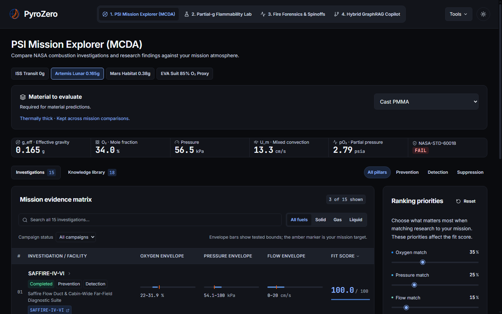
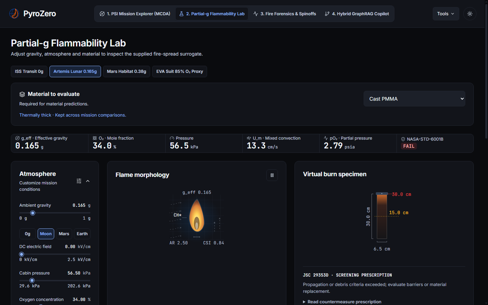
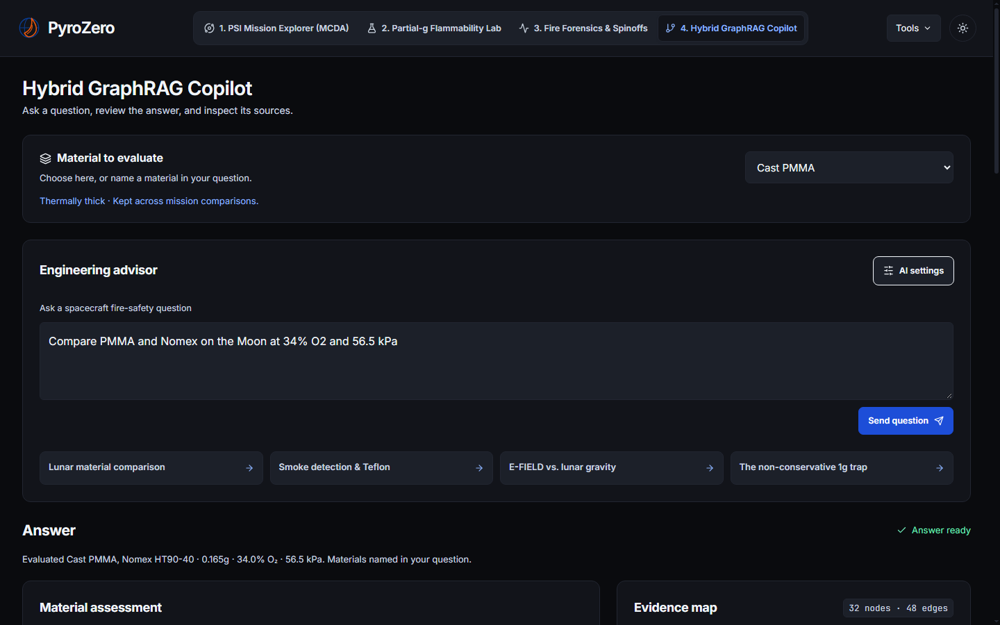
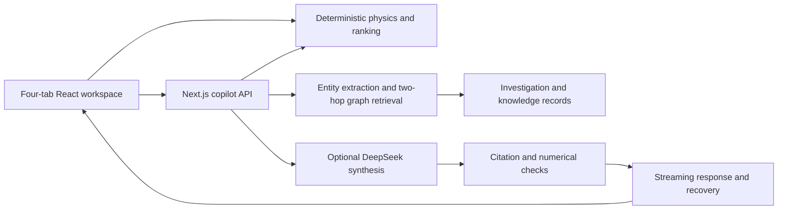

<p align="center">
  
</p>

<h1 align="center">Fire behaves differently when gravity changes.</h1>

<p align="center">A spacecraft fire research workspace connecting NASA combustion evidence,<br/>partial-gravity material screens, historical incidents, and cited engineering answers.</p>

<p align="center">
  <a href="https://pyrozero.vercel.app">Live workspace</a> ·
  <a href="#get-started">Run locally</a> ·
  <a href="#deepseek-generated-answers">DeepSeek setup</a> ·
  <a href="docs/release-verification-material-flow.md">QA evidence</a>
</p>

<p align="center">
  
  
  
  
</p>

> **Built by Zentrix Labs** for the 2026 NASA International Space Apps Challenge context, *Flame in Freefall*. This is an independent project, not NASA software or an endorsed material qualification tool. Research citations, supplied model parameters, and computed estimates have different evidentiary roles.

## Why PyroZero exists

A material that self-extinguishes during a terrestrial test can behave differently in a ventilated spacecraft. Gravity, oxygen enrichment, pressure, forced flow, and fuel properties interact; a familiar flame shape is a poor substitute for understanding the conditions behind it.

PyroZero makes those relationships inspectable. Start with a mission environment, choose a material explicitly, inspect the calculations, and follow the linked evidence. Then ask an engineering question and see the retrieved records, material screen, and explanation together.

The goal is to make a complex research landscape navigable for challenge judges, students, researchers, and curious engineers—not to turn a model prediction into flight approval.



<details>
<summary>See the Flammability Lab and Copilot</summary>





</details>

## One workspace, four ways to investigate

| Workspace | What you can do | What you can inspect |
| --- | --- | --- |
| **PSI Mission Explorer** | Compare 15 investigation groups against a mission profile; search and filter prevention, detection, and suppression evidence | Five MCDA sub-scores, adjustable priorities, atmosphere/flow coverage, source records, and evidence assessments |
| **Partial-g Flammability Lab** | Choose a material, adjust its environment, and compare modeled behavior across gravity levels | LOC boundary, NOMS, spread, burn length, Grashof/Reynolds/Damköhler numbers, morphology, and model limits |
| **Fire Forensics & Spinoffs** | Trace Apollo 1, Apollo 13, and Mir records; explore NASA-to-Earth engineering comparisons | Discrete report anchors, source context, bounded scenarios, interactive water mist, optical particle, and SCBA demonstrations |
| **Hybrid GraphRAG Copilot** | Ask a question in natural language; optionally generate a DeepSeek explanation | Extracted conditions, retrieved evidence, calculations, citations, and an interactive 67-node knowledge graph |

The catalogue also includes **6 materials**, **3 Earth spinoff comparisons**, **18 knowledge cards**, and a separately annotated mission smoke-alarm case. Investigation groups and graph nodes are different counts; a group can represent multiple related experiments.

### Mission profiles

| Preset | Gravity | Pressure | Oxygen | Forced flow |
| --- | ---: | ---: | ---: | ---: |
| ISS transit | 0g | 101.3 kPa | 21% | 15 cm/s |
| Artemis lunar | 0.165g | 56.5 kPa | 34% | 10 cm/s |
| Mars habitat | 0.38g | 56.5 kPa | 34% | 10 cm/s |
| EVA high-oxygen proxy | 0.165g | 29.6 kPa | 85% | 25 cm/s |

These are the project's comparison profiles. The EVA profile is an **85% oxygen model proxy**, not a simulation of pure oxygen.

### Material choice is part of the experiment

Available specimens are Cast PMMA, SIBAL fabric, Nomex HT90, nylon Velcro, PTFE Teflon, and Beta cloth/PBI. The last entry is a supplied catalogue/model grouping; Beta cloth and PBI are distinct technologies.

- A new session starts with **no confirmed material**. Material-dependent predictions stay empty until a choice is made.
- The selector stays visible above results; atmosphere controls remain in a separate disclosure.
- Mission presets preserve a material you deliberately selected.
- A historical scenario requires a fresh choice and identifies the relationship between its recorded fuel and the catalogue specimen.
- **Exit scenario** restores the prior atmosphere, material, confirmation state, and ranking priorities.
- If a flame is inactive, the interface explains the modeled oxygen limit or zero spread instead of leaving an unexplained blank animation.

Apollo 1 offers a nylon/Velcro analogue. Apollo 13 identifies the PTFE record but does not simulate a cryogenic oxygen tank using a bulk cabin specimen. Mir has no matching catalogue fuel. Bounded oxygen and pressure values are shown alongside reported conditions.

## What the engine computes

The deterministic TypeScript engine lives in [`src/lib/pyrozero-engine.ts`](src/lib/pyrozero-engine.ts). The UI and copilot share it; generated prose does not set the numerical results.

| Output | Meaning in this application |
| --- | --- |
| Flame temperature | Supplied logarithmic oxygen-enrichment relationship |
| Effective gravity | Ambient gravity plus supplied E-FIELD ion-drag equivalent |
| Mixed convection | Quadrature of forced and modeled buoyant velocities |
| Gr, Re, Da | Supplied transport and chemical-timescale relationships |
| LOC | Two-branch low-flow quench / high-flow blowoff surrogate |
| NOMS | `max(0, LOC at 1g − LOC at mission gravity)`, in oxygen percentage points |
| Flame spread | Supplied thermally thin or thick parameterization, gated by LOC |
| Burn length | Spread multiplied by the model's duration and capped at specimen length |
| Morphology | Aspect ratio and color/soot index used by the visualization |
| Mission ranking | Weighted oxygen, pressure, flow, fuel, and scale/diagnostic sub-scores |

**SIBAL calibration is preserved:** `spreadCoeff = 0.3147` produces **2.030 mm/s** at **0g / 100 kPa / 21% O₂ / 20 cm/s**. This is a one-point calibration to the supplied Saffire-II benchmark, not independent validation of the wider model.

`PASS`, `WARNING`, and `FAIL` describe a **virtual research screen**. They are not NASA certification, material-use approval, or a substitute for representative NASA-STD-6001 testing. The bulk specimen model does not implement a physical wire test. The supplied coefficients and all historical claims are not established as verified merely because they appear in the catalogue.

## DeepSeek generated answers

**Use a DeepSeek API key.** The app's visitor-key field is designed for DeepSeek, not an OpenAI or Gemini key.

### For visitors

1. Open **Hybrid GraphRAG Copilot → AI settings**.
2. Paste your **DeepSeek API key** and save.
3. Send a question. Your saved key overrides any shared server key for that request.
4. Use **Remove key** when finished on a shared device.

The key is stored in that browser's local storage. When you ask a question, it travels over HTTPS to PyroZero's server in the `x-deepseek-key` header; the server uses it to call DeepSeek. It is not embedded in public JavaScript or intentionally written to a database. Browser storage is accessible to scripts running on the same origin, so use a personal device and remove keys you no longer need. Provider usage is subject to your DeepSeek account, credits, and terms.

### For the Vercel project owner

In **Vercel → Project → Settings → Environment Variables**, add:

| Variable | Value | Scope |
| --- | --- | --- |
| `DEEPSEEK_API_KEY` | Your actual DeepSeek key | Production; server-only secret |
| `DEEPSEEK_MODEL` | `deepseek-chat` (optional; already the default) | Production |
| `NEXT_PUBLIC_SITE_URL` | Your production URL (optional) | Production; public metadata only |

**Redeploy after adding or changing environment variables.** Never prefix a provider secret with `NEXT_PUBLIC_`.

The shared key is optional. To end shared access, remove `DEEPSEEK_API_KEY` from Vercel, redeploy, and revoke the key in DeepSeek. Visitors can continue using their own keys afterward. Shared-key requests consume the owner's credits; monitor usage and set provider spending limits before sharing widely.

Without a configured provider key, the research workspace and deterministic calculations remain usable. The copilot displays an explicitly labelled **answer from research records**. It does not pretend that a fresh LLM explanation was generated. DeepSeek failures are shown with recovery controls rather than silently relabelled as generated answers.

The server retains optional legacy OpenAI/Gemini integrations for programmatic deployments. They are separate environment integrations, not accepted substitutes in the DeepSeek visitor-key field. See [`.env.example`](.env.example).

### Answer lifecycle and grounding

A submitted question shows loading skeletons, prevents duplicate sends, supports Stop, and scrolls to the response. Completed answers expose their material/condition context. Questions without a selected or named material can retrieve evidence without inventing a PMMA simulation; materials named in a question take precedence over the workspace selection.

DeepSeek receives retrieved findings and deterministic calculations. Completion checks constrain citation identifiers, numerical tokens, and prohibited qualification claims. Calculation links lead to the material assessment; source links lead to cited records. These checks reduce specific errors but do not prove every sentence true. Review original sources before relying on an answer.

## Get started

Requires **Node.js 22.12+** and npm. No API key is needed to explore the application.

```sh
git clone https://github.com/aarizmehdi/PyroZero.git
cd PyroZero
npm ci
npm run dev
```

Open [localhost:3000](http://localhost:3000). For optional local server credentials, copy `.env.example` to `.env.local` and fill in only what you need. `.env.local` is ignored by Git. Do not commit real credentials.

```sh
npm run typecheck
npm run lint
npm test
npm run build
npm start
```

`npm run build` builds Next.js and also packages the existing Sites Worker target. Vercel uses the `npx next build` override in [`vercel.json`](vercel.json) and hosts the native App Router API. The Worker remains an alternative deployment target; neither host needs the other's runtime.

## Deploy your own Vercel instance

1. Import this GitHub repository into Vercel as a **Next.js** project.
2. Use Node.js **22.x or newer**, repository root, and the checked-in Vercel configuration.
3. Deploy without secrets to verify the reference-answer experience.
4. Optionally add the server-only DeepSeek variables described above and redeploy.
5. Visit all four tabs and verify a real generated answer with your own key.

The API route declares a 90-second function duration to accommodate its 60-second provider deadline and request processing. Actual platform limits depend on your Vercel plan. No database is required. Preferences, onboarding completion, and visitor-key persistence use browser storage.

## Architecture



| Path | Responsibility |
| --- | --- |
| `src/components/workspace.tsx` | Shared workspace, navigation, advisor, settings, and result states |
| `src/components/material-selection.tsx` | Explicit, accessible specimen choice |
| `src/components/scientific-plots.tsx` | LOC plot, flame morphology, and virtual specimen |
| `src/components/spinoff-*` | Three.js demonstrations and linked workbench controls |
| `src/lib/simulation-session.ts` | Mission/scenario transitions and reversible state restoration |
| `src/lib/pyrozero-engine.ts` | Supplied equations, parameters, units, and ranking |
| `src/lib/graphrag-engine.ts` | Query extraction, graph traversal, material scope, and evidence assembly |
| `src/lib/copilot-service.ts` | Request validation, provider calls, streaming, and completion checks |
| `src/app/api/copilot/route.ts` | Native Next.js server endpoint and server-only configuration |
| `src/data/` | Canonical catalogue and separate provenance/evidence annotations |
| `scripts/` | Build targets and browser verification tooling |
| `docs/` | Audits, QA reports, screenshots, and model qualifications |

### API example

```js
const response = await fetch('/api/copilot', {
  method: 'POST',
  headers: { 'Content-Type': 'application/json' },
  body: JSON.stringify({
    query: 'Compare PMMA and Nomex on the Moon at 34% O2 and 56.5 kPa',
    requireExplicitMaterial: true
  })
});
// Consume response.body as a text/event-stream.
```

The stream includes computed `result`, provider `mode`, generated `token`, completion `done`, and error information as applicable. Requests are bounded to 32 KiB and questions to 8,000 characters. Disconnects cancel provider work. Send `x-deepseek-key` only over HTTPS to a deployment you trust; never put a key in a URL.

## Verification you can inspect

The material-flow release passed **138 unit tests in 12 files**, including a **4,608-combination** parameter sweep. Browser reports cover all four workspaces on desktop/mobile in Light and Dark modes, material empty states, scenario restoration, exports, graph controls, onboarding, and Three.js interactions.

Three live DeepSeek questions were reviewed against the computed values and supplied evidence. A real browser check confirmed the calibrated SIBAL result, generated text, calculation links, and mobile containment. Intermittent provider failures were also observed and recorded. These are scoped test results, not a promise that every future provider response is correct.

- [Latest complete beta report](docs/release-verification-material-flow.md)
- [Material and responsive results](docs/material-beta-results.json)
- [Scenario review](docs/scenario-review-results.json)
- [Live-provider review](docs/live-provider-review.json)
- [Live-answer browser check](docs/live-ai-browser-results.json)
- [3D interaction checks](docs/spinoff-3d-results.json)
- [Credential scan](docs/credential-audit-results.json)

For a local headless pass against a running server:

```sh
npm run test:browser -- http://127.0.0.1:3000
```

The verification scripts use installed Chrome or Edge; set `CHROME_PATH` when necessary. The screenshot and JSON files document particular release runs. They do not automatically update when a browser, provider, or dataset changes.

## Evidence and scientific boundaries

Start with [NASA Physical Sciences Informatics / BPS data](https://science.nasa.gov/biological-physical/data/) and the [NASA Technical Reports Server](https://ntrs.nasa.gov/). PyroZero links investigation-level sources and keeps additional evidence assessments separate from the supplied canonical payload.

- The engineering model implements the project's supplied equations and parameter tables. Conformance to those tables is different from experimental validation.
- Historical incident panels use discrete anchors and bounded analogue environments; they do not reconstruct an accident.
- The Three.js demonstrations explain relationships visually. They are not CFD, calibrated optical classifiers, or breathing-apparatus certification models.
- The knowledge graph shows retrieval relationships. An edge is not proof of causation.
- Some publisher pages restrict automated access. DOI identity checks are not full-text scientific review.
- No model result or AI answer authorizes cabin use, material substitution, emergency procedures, or flight operations.

## Design and accessibility

The interface supports persistent Light/Dark themes, keyboard-accessible controls, a skip link, labelled material selection, loading/status feedback, reduced-motion behavior, and responsive layouts. A first-visit tour can be skipped and replayed from Tools. The material/scenario flow follows [Jakob Nielsen's usability heuristics](https://www.nngroup.com/articles/ten-usability-heuristics/): visible state, recognition, error prevention, and a clear reversible exit.

Self-hosted font licenses are included in `public/fonts/`. The PyroZero globe-and-flame mark is reused across the navigation, favicon, README wordmark, and share card.

## About Zentrix Labs

**PyroZero is engineered by Zentrix Labs, the R&D division of Zentrix Edge.** It brings research discovery, explicit assumptions, computational transparency, and approachable interaction into one spacecraft-fire workspace.

For bugs or suggestions, [open an issue](https://github.com/aarizmehdi/PyroZero/issues). Include the affected tab, device/viewport, theme, material, atmosphere, expected behavior, and observed behavior. **Never attach API keys or unredacted credentials.**

### Repository use and attribution

No open-source license is granted unless a license file is added by the owner. Source visibility does not itself grant redistribution rights. Third-party software and fonts retain their own licenses; NASA publications and other cited research retain their applicable terms and attribution requirements.

---

<p align="center"><strong>PyroZero · Zentrix Labs</strong><br/>Explore the evidence. Inspect the assumptions. Understand the limits.</p>
